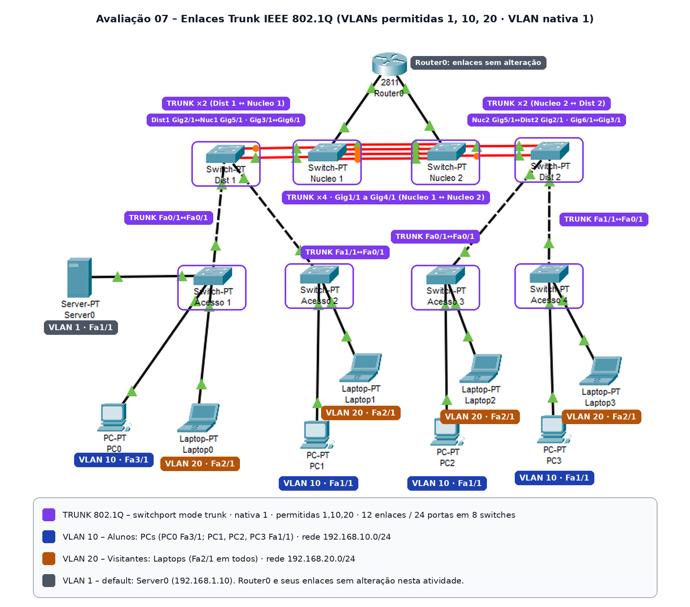
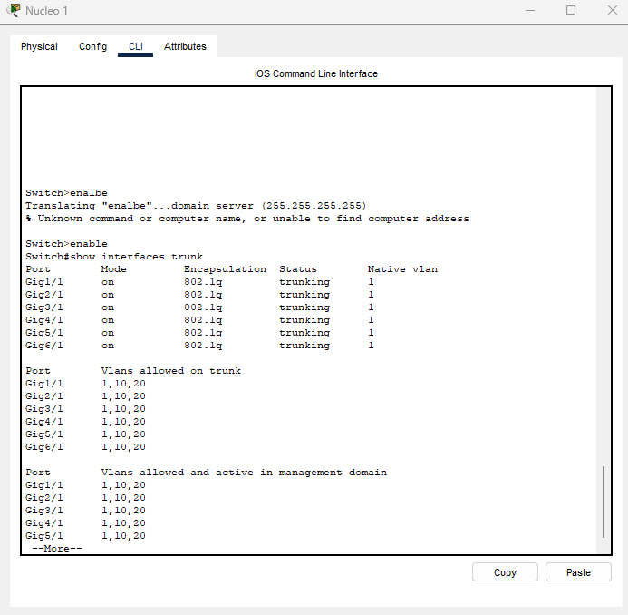
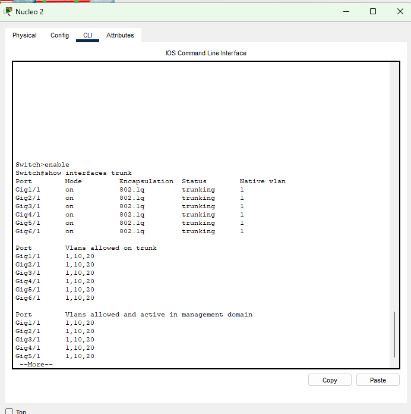
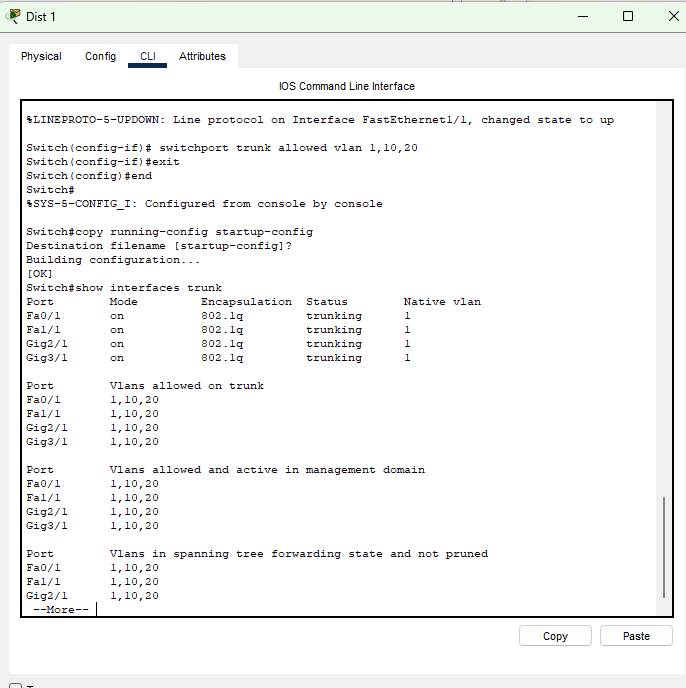
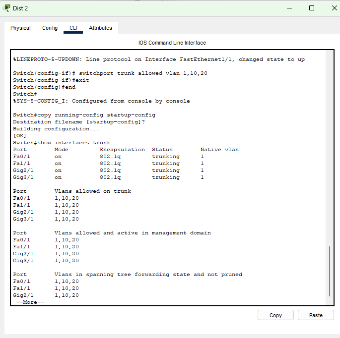
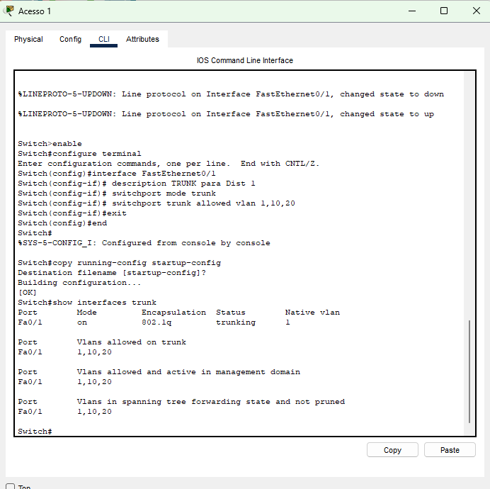
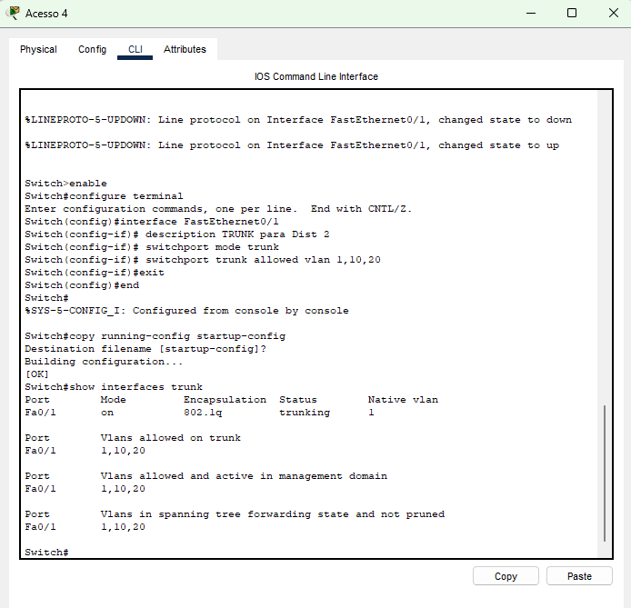
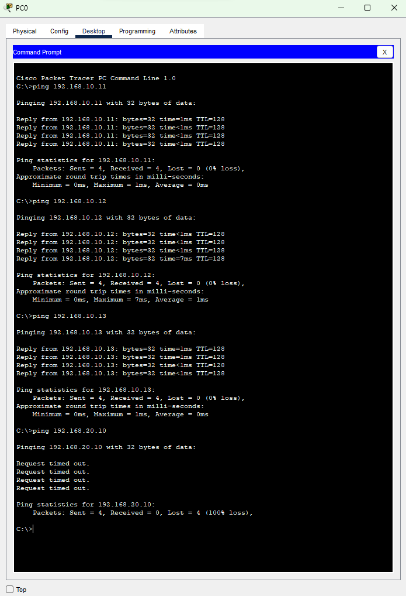
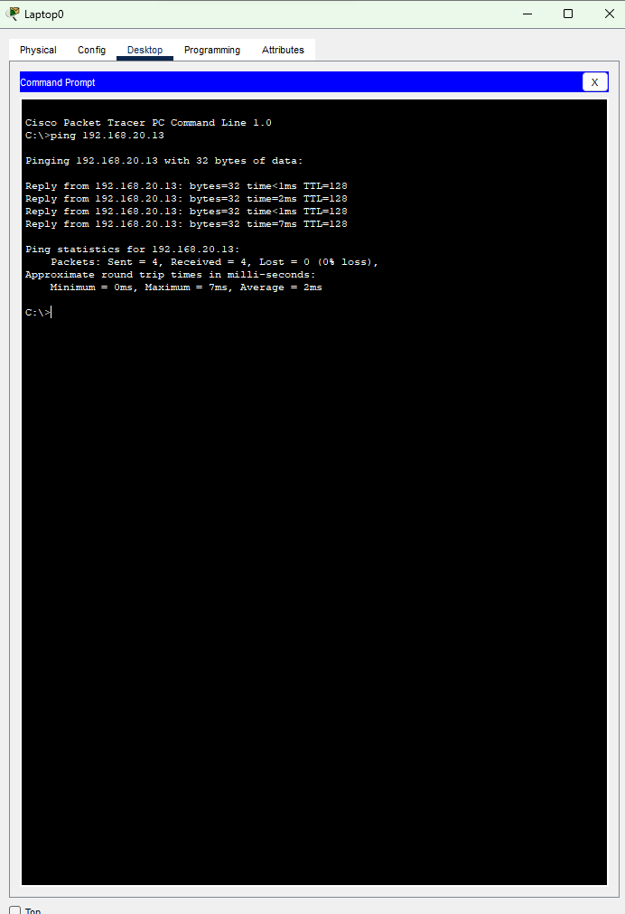

# Avaliação 07 – Configuração de VLANs tipo Trunk (IEEE 802.1Q)

**Disciplina:** TCN.0639 – Comutação de Redes Locais  
**Curso:** Tecnologia em Redes de Computadores – IFRO Campus Porto Velho Zona Norte  
**Ferramenta:** Cisco Packet Tracer

## 1. Objetivo

Configurar o entroncamento (modo trunk) nas portas que interligam os switches das camadas de Acesso, Distribuição e Núcleo, permitindo que as VLANs 10 (Alunos) e 20 (Visitantes), criadas na Avaliação 06, trafeguem por toda a rede hierárquica.

## 2. Fundamentação: IEEE 802.1Q

### 2.1 Porta de acesso e porta trunk

- **Porta de acesso:** pertence a uma única VLAN. Liga dispositivos finais (PCs, laptops, servidores). Os quadros saem sem marcação.
- **Porta trunk:** transporta quadros de várias VLANs pelo mesmo enlace físico. Liga switch a switch. Isso é a multiplexação de VLANs em um único cabo.

### 2.2 Encapsulamento

Para que o switch vizinho saiba a qual VLAN cada quadro pertence, o padrão IEEE 802.1Q insere uma marcação (tag) de 4 bytes no quadro Ethernet, entre o endereço MAC de origem e o campo Tipo (EtherType):

| Campo | Tamanho | Função |
|---|---|---|
| TPID | 16 bits | Valor 0x8100; identifica o quadro como 802.1Q |
| PCP | 3 bits | Prioridade (QoS), de 0 a 7 |
| DEI | 1 bit | Indica se o quadro pode ser descartado em congestionamento |
| VID | 12 bits | Identificador da VLAN (1 a 4094 utilizáveis) |

Com a tag, o quadro fica 4 bytes maior (máximo de 1522 bytes, conforme IEEE 802.3ac) e o FCS é recalculado. A tag existe apenas no trunk: o switch de acesso a remove antes de entregar o quadro ao dispositivo final.

### 2.3 VLAN nativa

A VLAN nativa é a VLAN cujos quadros atravessam o trunk **sem tag**. Quadros sem tag recebidos em uma porta trunk são associados a ela. O padrão é a VLAN 1, e o valor deve ser igual nas duas pontas do enlace; caso contrário, o tráfego cai na VLAN errada.

### 2.4 VLANs nos switches intermediários

Um switch só encaminha quadros de VLANs que existem em sua base de VLANs. Por isso, as VLANs 10 e 20 também foram criadas nos switches de Distribuição e Núcleo, por onde o tráfego passa.

## 3. Diagrama da topologia



## 4. VLANs

| ID | Nome | Rede IP | Dispositivos |
|---|---|---|---|
| 10 | Alunos | 192.168.10.0/24 | PC0, PC1, PC2, PC3 |
| 20 | Visitantes | 192.168.20.0/24 | Laptop0, Laptop1, Laptop2, Laptop3 |
| 1 | default | 192.168.1.0/24 | Server0 |

**Parâmetros dos trunks:** encapsulamento 802.1Q · VLAN nativa 1 · VLANs permitidas 1,10,20

## 5. Mapeamento das interfaces

### 5.1 Portas trunk (configuradas nesta atividade)

| Switch | Camada | Interface | Conectada a | Modo | Nativa | VLANs permitidas |
|---|---|---|---|---|---|---|
| Nucleo 1 | Núcleo | GigabitEthernet1/1 | Nucleo 2 | trunk | 1 | 1,10,20 |
| Nucleo 1 | Núcleo | GigabitEthernet2/1 | Nucleo 2 | trunk | 1 | 1,10,20 |
| Nucleo 1 | Núcleo | GigabitEthernet3/1 | Nucleo 2 | trunk | 1 | 1,10,20 |
| Nucleo 1 | Núcleo | GigabitEthernet4/1 | Nucleo 2 | trunk | 1 | 1,10,20 |
| Nucleo 1 | Núcleo | GigabitEthernet5/1 | Dist 1 | trunk | 1 | 1,10,20 |
| Nucleo 1 | Núcleo | GigabitEthernet6/1 | Dist 1 | trunk | 1 | 1,10,20 |
| Nucleo 2 | Núcleo | GigabitEthernet1/1 | Nucleo 1 | trunk | 1 | 1,10,20 |
| Nucleo 2 | Núcleo | GigabitEthernet2/1 | Nucleo 1 | trunk | 1 | 1,10,20 |
| Nucleo 2 | Núcleo | GigabitEthernet3/1 | Nucleo 1 | trunk | 1 | 1,10,20 |
| Nucleo 2 | Núcleo | GigabitEthernet4/1 | Nucleo 1 | trunk | 1 | 1,10,20 |
| Nucleo 2 | Núcleo | GigabitEthernet5/1 | Dist 2 | trunk | 1 | 1,10,20 |
| Nucleo 2 | Núcleo | GigabitEthernet6/1 | Dist 2 | trunk | 1 | 1,10,20 |
| Dist 1 | Distribuição | GigabitEthernet2/1 | Nucleo 1 | trunk | 1 | 1,10,20 |
| Dist 1 | Distribuição | GigabitEthernet3/1 | Nucleo 1 | trunk | 1 | 1,10,20 |
| Dist 1 | Distribuição | FastEthernet0/1 | Acesso 1 | trunk | 1 | 1,10,20 |
| Dist 1 | Distribuição | FastEthernet1/1 | Acesso 2 | trunk | 1 | 1,10,20 |
| Dist 2 | Distribuição | GigabitEthernet2/1 | Nucleo 2 | trunk | 1 | 1,10,20 |
| Dist 2 | Distribuição | GigabitEthernet3/1 | Nucleo 2 | trunk | 1 | 1,10,20 |
| Dist 2 | Distribuição | FastEthernet0/1 | Acesso 3 | trunk | 1 | 1,10,20 |
| Dist 2 | Distribuição | FastEthernet1/1 | Acesso 4 | trunk | 1 | 1,10,20 |
| Acesso 1 | Acesso | FastEthernet0/1 | Dist 1 | trunk | 1 | 1,10,20 |
| Acesso 2 | Acesso | FastEthernet0/1 | Dist 1 | trunk | 1 | 1,10,20 |
| Acesso 3 | Acesso | FastEthernet0/1 | Dist 2 | trunk | 1 | 1,10,20 |
| Acesso 4 | Acesso | FastEthernet0/1 | Dist 2 | trunk | 1 | 1,10,20 |

### 5.2 Portas de acesso (Avaliação 06, sem alteração)

| Switch | Interface | Dispositivo | IP | VLAN |
|---|---|---|---|---|
| Acesso 1 | FastEthernet3/1 | PC0 | 192.168.10.10 | 10 – Alunos |
| Acesso 1 | FastEthernet2/1 | Laptop0 | 192.168.20.10 | 20 – Visitantes |
| Acesso 1 | FastEthernet1/1 | Server0 | 192.168.1.10 | 1 – default |
| Acesso 2 | FastEthernet1/1 | PC1 | 192.168.10.11 | 10 – Alunos |
| Acesso 2 | FastEthernet2/1 | Laptop1 | 192.168.20.11 | 20 – Visitantes |
| Acesso 3 | FastEthernet1/1 | PC2 | 192.168.10.12 | 10 – Alunos |
| Acesso 3 | FastEthernet2/1 | Laptop2 | 192.168.20.12 | 20 – Visitantes |
| Acesso 4 | FastEthernet1/1 | PC3 | 192.168.10.13 | 10 – Alunos |
| Acesso 4 | FastEthernet2/1 | Laptop3 | 192.168.20.13 | 20 – Visitantes |

### 5.3 Enlaces fora do escopo

- Router0 ↔ Nucleo 1 e Router0 ↔ Nucleo 2: sem alteração (roteamento entre VLANs não faz parte desta atividade).

## 6. Comandos Cisco IOS

### 6.1 Explicação dos comandos

| Comando | Modo | Função |
|---|---|---|
| `enable` | `Switch>` | Entra no modo privilegiado |
| `configure terminal` | `Switch#` | Entra no modo de configuração global |
| `vlan N` / `name NOME` | `Switch(config)#` | Cria a VLAN e define o nome |
| `interface TIPOX/Y` | `Switch(config)#` | Seleciona a interface |
| `description TEXTO` | `Switch(config-if)#` | Descrição da interface |
| `switchport mode trunk` | `Switch(config-if)#` | Força a interface para o modo trunk |
| `switchport trunk allowed vlan LISTA` | `Switch(config-if)#` | Define as VLANs permitidas no trunk |
| `end` | qualquer modo de configuração | Volta ao modo privilegiado |
| `copy running-config startup-config` | `Switch#` | Salva a configuração na NVRAM |
| `show interfaces trunk` | `Switch#` | Lista as portas trunk e as VLANs permitidas |
| `show interfaces X switchport` | `Switch#` | Mostra o modo e os parâmetros da porta |
| `show vlan brief` | `Switch#` | Lista as VLANs e as portas de acesso |

### 6.2 Sequência de configuração (ordem: Núcleo → Distribuição → Acesso)

#### 6.2.1 Nucleo 1

```
enable
configure terminal
vlan 10
 name Alunos
 exit
vlan 20
 name Visitantes
 exit
interface GigabitEthernet1/1
 description TRUNK para Nucleo 2
 switchport mode trunk
 switchport trunk allowed vlan 1,10,20
 exit
interface GigabitEthernet2/1
 description TRUNK para Nucleo 2
 switchport mode trunk
 switchport trunk allowed vlan 1,10,20
 exit
interface GigabitEthernet3/1
 description TRUNK para Nucleo 2
 switchport mode trunk
 switchport trunk allowed vlan 1,10,20
 exit
interface GigabitEthernet4/1
 description TRUNK para Nucleo 2
 switchport mode trunk
 switchport trunk allowed vlan 1,10,20
 exit
interface GigabitEthernet5/1
 description TRUNK para Dist 1
 switchport mode trunk
 switchport trunk allowed vlan 1,10,20
 exit
interface GigabitEthernet6/1
 description TRUNK para Dist 1
 switchport mode trunk
 switchport trunk allowed vlan 1,10,20
 exit
end
copy running-config startup-config
```

#### 6.2.2 Nucleo 2

```
enable
configure terminal
vlan 10
 name Alunos
 exit
vlan 20
 name Visitantes
 exit
interface GigabitEthernet1/1
 description TRUNK para Nucleo 1
 switchport mode trunk
 switchport trunk allowed vlan 1,10,20
 exit
interface GigabitEthernet2/1
 description TRUNK para Nucleo 1
 switchport mode trunk
 switchport trunk allowed vlan 1,10,20
 exit
interface GigabitEthernet3/1
 description TRUNK para Nucleo 1
 switchport mode trunk
 switchport trunk allowed vlan 1,10,20
 exit
interface GigabitEthernet4/1
 description TRUNK para Nucleo 1
 switchport mode trunk
 switchport trunk allowed vlan 1,10,20
 exit
interface GigabitEthernet5/1
 description TRUNK para Dist 2
 switchport mode trunk
 switchport trunk allowed vlan 1,10,20
 exit
interface GigabitEthernet6/1
 description TRUNK para Dist 2
 switchport mode trunk
 switchport trunk allowed vlan 1,10,20
 exit
end
copy running-config startup-config
```

#### 6.2.3 Dist 1

```
enable
configure terminal
vlan 10
 name Alunos
 exit
vlan 20
 name Visitantes
 exit
interface GigabitEthernet2/1
 description TRUNK para Nucleo 1
 switchport mode trunk
 switchport trunk allowed vlan 1,10,20
 exit
interface GigabitEthernet3/1
 description TRUNK para Nucleo 1
 switchport mode trunk
 switchport trunk allowed vlan 1,10,20
 exit
interface FastEthernet0/1
 description TRUNK para Acesso 1
 switchport mode trunk
 switchport trunk allowed vlan 1,10,20
 exit
interface FastEthernet1/1
 description TRUNK para Acesso 2
 switchport mode trunk
 switchport trunk allowed vlan 1,10,20
 exit
end
copy running-config startup-config
```

#### 6.2.4 Dist 2

```
enable
configure terminal
vlan 10
 name Alunos
 exit
vlan 20
 name Visitantes
 exit
interface GigabitEthernet2/1
 description TRUNK para Nucleo 2
 switchport mode trunk
 switchport trunk allowed vlan 1,10,20
 exit
interface GigabitEthernet3/1
 description TRUNK para Nucleo 2
 switchport mode trunk
 switchport trunk allowed vlan 1,10,20
 exit
interface FastEthernet0/1
 description TRUNK para Acesso 3
 switchport mode trunk
 switchport trunk allowed vlan 1,10,20
 exit
interface FastEthernet1/1
 description TRUNK para Acesso 4
 switchport mode trunk
 switchport trunk allowed vlan 1,10,20
 exit
end
copy running-config startup-config
```

#### 6.2.5 Acesso 1

```
enable
configure terminal
interface FastEthernet0/1
 description TRUNK para Dist 1
 switchport mode trunk
 switchport trunk allowed vlan 1,10,20
 exit
end
copy running-config startup-config
```

#### 6.2.6 Acesso 2

```
enable
configure terminal
interface FastEthernet0/1
 description TRUNK para Dist 1
 switchport mode trunk
 switchport trunk allowed vlan 1,10,20
 exit
end
copy running-config startup-config
```

#### 6.2.7 Acesso 3

```
enable
configure terminal
interface FastEthernet0/1
 description TRUNK para Dist 2
 switchport mode trunk
 switchport trunk allowed vlan 1,10,20
 exit
end
copy running-config startup-config
```

#### 6.2.8 Acesso 4

```
enable
configure terminal
interface FastEthernet0/1
 description TRUNK para Dist 2
 switchport mode trunk
 switchport trunk allowed vlan 1,10,20
 exit
end
copy running-config startup-config
```

## 7. Validação

Comandos executados em cada switch:

```
show interfaces trunk
show interfaces <porta> switchport
show vlan brief
```

**Nucleo 1 – show interfaces trunk**



**Nucleo 2 – show interfaces trunk**



**Dist 1 – show interfaces trunk**



**Dist 2 – show interfaces trunk**



**Acesso 1 – show interfaces trunk**



**Acesso 2 – show interfaces trunk**


**Acesso 3 – show interfaces trunk**


**Acesso 4 – show interfaces trunk**



### 7.1 Testes de ping

| Origem → Destino | VLANs | Caminho | Resultado |
|---|---|---|---|
| PC0 (192.168.10.10) → PC1 (192.168.10.11) | 10 → 10 | Acesso 1 → Dist 1 → Acesso 2 | Sucesso |
| PC0 (192.168.10.10) → PC2 (192.168.10.12) | 10 → 10 | Passa pelos dois núcleos | Sucesso |
| PC0 (192.168.10.10) → PC3 (192.168.10.13) | 10 → 10 | Passa pelos dois núcleos | Sucesso |
| Laptop0 (192.168.20.10) → Laptop3 (192.168.20.13) | 20 → 20 | Passa pelos dois núcleos | Sucesso |
| PC0 (192.168.10.10) → Laptop0 (192.168.20.10) | 10 → 20 | — | Falha (esperado: sem roteamento entre VLANs) |

**Pings a partir do PC0 (VLAN 10):**



**Ping a partir do Laptop0 (VLAN 20):**



Na Avaliação 06, o ping entre dispositivos da mesma VLAN em switches diferentes falhava, porque os uplinks não eram trunk. Após a configuração, ele passou a funcionar. O ping entre VLANs diferentes continua falhando, como esperado, pois não há roteamento entre VLANs.

## 8. Observações

- As VLANs 10 e 20 foram criadas também nos switches de Distribuição e Núcleo, pois todo switch no caminho precisa conhecer a VLAN.
- Nos enlaces com cabos paralelos (Núcleo–Núcleo e Núcleo–Distribuição), o Spanning Tree bloqueia parte das portas para evitar laços. A agregação desses cabos (EtherChannel) é tema da próxima atividade.
- A VLAN nativa foi mantida no padrão (VLAN 1) em todos os trunks.

## 9. Arquivos do repositório

| Arquivo | Conteúdo |
|---|---|
| `README.md` | Este tutorial |
| `topologia.png` | Diagrama atualizado |
| `show-trunk-*.png` | Saídas do `show interfaces trunk` |
| `teste-ping.png` | Testes de conectividade a partir do PC0 |
| `teste-ping-vlan20.png` | Teste de conectividade da VLAN 20 |
| `Atividade_07.pkt` | Arquivo do Cisco Packet Tracer |

## 10. Referências

- Slides da disciplina TCN.0639 – Comutação de Redes Locais (VLANs: tipos access e trunk).
- IEEE 802.1Q – Bridges and Bridged Networks (VLAN tagging).
- IEEE 802.3ac – extensão do tamanho máximo do quadro para VLAN tagging.
- Documentação Cisco IOS dos switches Catalyst (configuração de VLANs e trunks).
